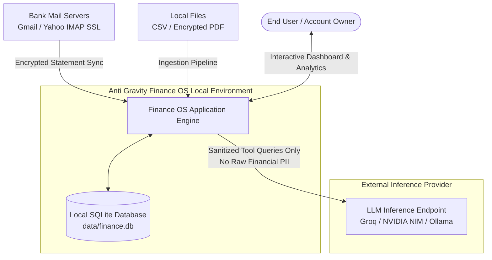
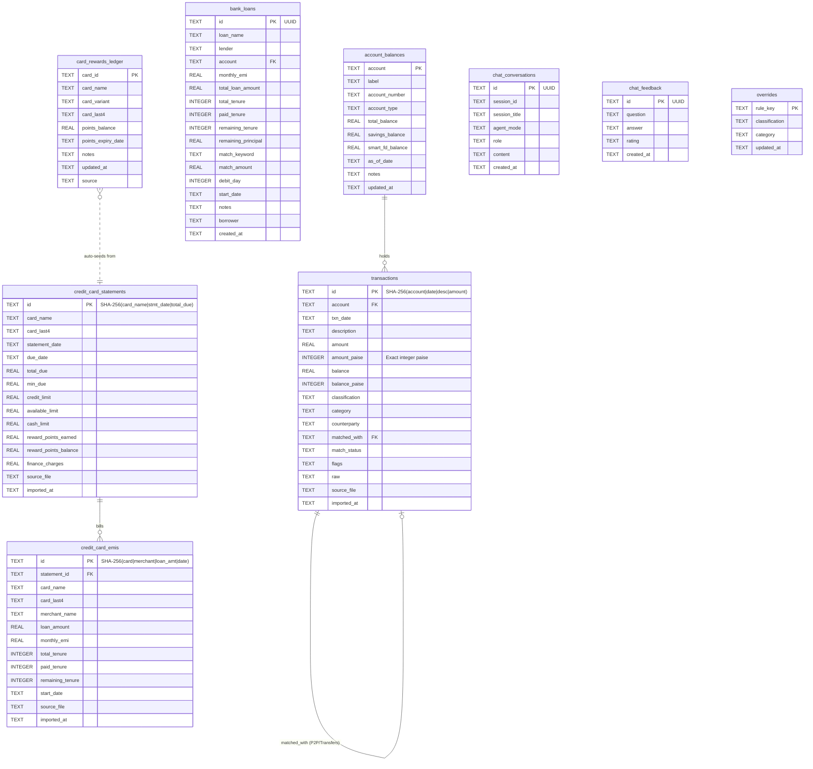
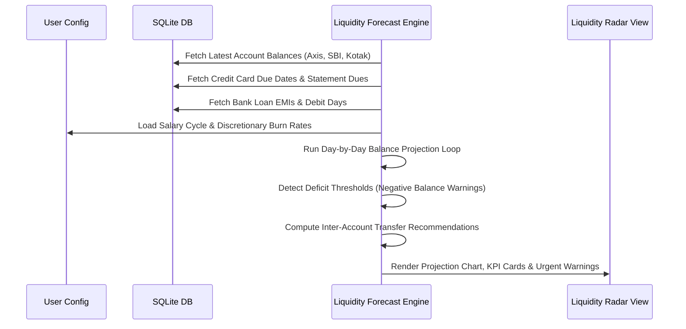
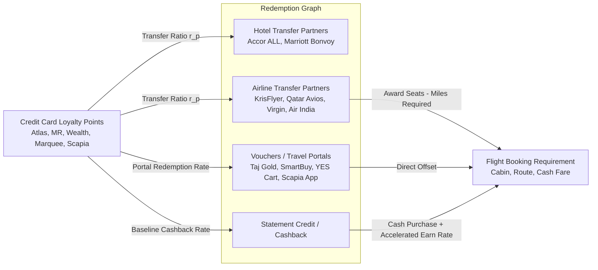

# System & Data Architecture Specification
**Anti Gravity Finance OS — Enterprise Technical Blueprint**
*Target Audience: Solution Architects, Data Architects, Technical Leads, and Security Reviewers*

---

## 1. Executive Architecture Summary & Design Principles

**Anti Gravity Finance OS** is a local-first, privacy-preserving financial intelligence platform engineered to consolidate multi-bank accounts, complex credit card portfolios with shared credit limits, active personal/NBFC loans, bilateral peer-to-peer pass-through liabilities, and multi-program loyalty rewards into a single deterministic ledger and real-time AI advisory system.

### Core Architectural Tenets

```
┌─────────────────────────────────────────────────────────────────────────────┐
│                             ARCHITECTURAL TENETS                            │
├─────────────────────────┬─────────────────────────┬─────────────────────────┤
│    1. LOCAL-FIRST &     │    2. DETERMINISTIC     │     3. INTEGER-PAISE    │
│       ZERO-LEAK         │       IDEMPOTENCY       │        PRECISION        │
│ All data persists in    │ Any statement can be    │ Financial math strictly │
│ SQLite WAL locally.     │ re-imported N times;    │ in integer paise to     │
│ Zero financial figures  │ SHA-256 dedupe keys     │ eliminate IEEE 754      │
│ sent to external cloud. │ ensure exactly-once.    │ floating-point drift.   │
├─────────────────────────┼─────────────────────────┼─────────────────────────┤
│    4. DECOUPLED BI &    │  5. POLICY-GUARDED AI   │  6. REVENUE OPTIMIZED   │
│     SIMULATION CORE     │       TOOLING           │      POINTS GRAPH       │
│ Proactive 30-day radar  │ LLMs never guess;       │ Multi-tier graph to     │
│ runs deterministic day- │ dynamic SQL tools query │ optimize loyalty points │
│ by-day cashflow models. │ live schema boundaries. │ vs cash transactions.   │
└─────────────────────────┴─────────────────────────┴─────────────────────────┘
```

---

## 2. High-Level Architecture (C4 Model)

### 2.1 System Context (Level 1)


### 2.2 Container Architecture (Level 2)
```mermaid
flowchart TB
    subgraph Presentation_Layer [Presentation Layer (Streamlit)]
        UI_Overview[Overview & Net Worth]
        UI_Radar[30-Day Liquidity Radar]
        UI_Recon[Ashwin Reconciliation]
        UI_Cards[Credit Cards & EMI Matrix]
        UI_Rewards[Rewards & Miles Optimizer]
        UI_Loans[Bank Loans & Debt-Free Tracker]
        UI_Txns[Bank Ledger & Categorization]
        UI_AI[Master Financial AI Chat]
        UI_History[Logs, History & Transcripts]
    end

    subgraph Service_Layer [Service & Analytics Engines]
        ForecastEngine[Cashflow & Liquidity Forecast Simulator]
        RewardsEngine[Loyalty Valuation & Award Flight Optimizer]
        ReconEngine[Non-Greedy Bilateral Reconciliation Engine]
        Classifier[Tokenizing Classifier & Rules Engine]
        AIAgent[LangGraph Master Financial AI Orchestrator]
    end

    subgraph Ingestion_Layer [Data Ingestion & Normalization Layer]
        IMAPSync[IMAP Statement Harvester]
        PDFParser[PDF Layout Decryption & Parsing Engine]
        CSVIngest[Multiline CSV Normalizer]
        DedupeEngine[SHA-256 Deduplication & Canonicalizer]
    end

    subgraph Persistence_Layer [Persistence Layer (SQLite WAL)]
        TxnTable[(transactions)]
        CCTable[(credit_card_statements)]
        CCEMITable[(credit_card_emis)]
        LoansTable[(bank_loans)]
        RewardsTable[(card_rewards_ledger)]
        BalancesTable[(account_balances)]
        ChatTable[(chat_conversations)]
    end

    Presentation_Layer --> Service_Layer
    Service_Layer --> Persistence_Layer
    Ingestion_Layer --> Service_Layer
    Ingestion_Layer --> Persistence_Layer
```

---

## 3. Data Architecture & Schema Specification

The storage layer is implemented entirely in SQLite with Write-Ahead Logging (`PRAGMA journal_mode = WAL;`) and relaxed synchronicity (`PRAGMA synchronous = NORMAL;`), allowing non-blocking concurrent reads while background pipeline tasks write transactions.

### 3.1 Entity Relationship Diagram (ERD)


### 3.2 Key Data Types and Column Invariants

1. **`transactions.amount_paise`**:
   - Stores the exact integer value of the transaction in Indian Paise (`₹1.00 = 100 paise`).
   - Positive for incoming credits (+), negative for outgoing debits (-).
   - Invariant: `amount_paise == round(amount * 100)`. All reconciliation logic compares paise to eliminate floating-point drift.
2. **`transactions.id`**:
   - Primary Key constructed via:
     $$\text{ID} = \text{SHA256}(\text{account} \parallel \text{txn\_date} \parallel \text{clean\_description} \parallel \text{amount})$$
   - Ensures strict idempotency across overlapping monthly statements.
3. **`credit_card_statements`**:
   - Tracks both individual physical cards (e.g. Axis Atlas vs Ace) and unified credit pools (e.g. shared ₹3,00,000 credit limit).
4. **`card_rewards_ledger`**:
   - Tracks reward balances per physical card, with card tier variant specifications (e.g., Axis Atlas vs Magnus vs General EDGE) enabling real-time valuation calculations.

---

## 4. Algorithmic Models & Computational Engines

### 4.1 Liquidity Forecast & Proactive Cashflow Simulator
The Liquidity Radar models the financial state over a continuous $[T_0, T_0 + 30\text{ days}]$ projection horizon.



#### Mathematical Formulation:
For each account $a \in \mathcal{A}$ on day $t \in [0, 30]$:
$$B_a(t) = B_a(t-1) + S_a(t) + I_a(t) - E_a(t) - L_a(t) - C_a(t) - D_a(t)$$
Where:
- $B_a(t)$: Projected balance of account $a$ on day $t$.
- $S_a(t)$: Scheduled salary credit (if $t = \text{salary\_day}$).
- $I_a(t)$: Recurring inbound peer deposits (e.g. Ashwin settlement).
- $E_a(t)$: Scheduled credit card bill debits on due date.
- $L_a(t)$: Bank loan auto-debits on loan debit day.
- $C_a(t)$: Scheduled recurring commitments (e.g., rent, utilities).
- $D_a(t)$: Daily smoothed lifestyle burn rate $\left(\frac{\text{3-month average spend}}{30}\right)$.

If $\exists t$ such that $B_a(t) < \text{Minimum Balance Threshold}$, the engine triggers an **Urgent Inter-Account Transfer Action**, calculating:
$$\Delta_{\text{transfer}} = (\text{Target Buffer} - B_a(t))$$
and selecting the surplus donor account with the lowest opportunity cost.

---

### 4.2 Bilateral Reconciliation & Smart Matching Engine
Used to reconcile pass-through credit card spending with third-party deposits (e.g., Ashwin):
1. **Pass-Through Filtering**: Identifies all credit card payments made on behalf of the third party.
2. **Deposit Pairing**: Matches bank deposit credits against corresponding credit card bills or pass-through expenses.
3. **Tolerance Drift ($\pm ₹1.00$)**:
   $$\left|\text{Deposit Amount} - \text{Billed Amount}\right| \le 1.00$$
   Accommodates payment gateway transaction charges and rounding variations.
4. **Non-Greedy Temporal Assignment**: Matches closest date chronologically within the billing period, preserving any manual overrides entered by the user.

---

### 4.3 Rewards & Miles Valuation Graph Engine
The Rewards Optimizer models reward programs as a directed valuation graph:



#### Valuation Formula:
For a card point currency $C$ with balance $P_C$ and partner program $p$:
$$\text{Partner Units} = \left(\frac{P_C}{U_C}\right) \times U_p$$
$$\text{Effective Value (INR)} = \text{Partner Units} \times V_p$$
$$\text{Effective Yield (INR/Point)} = \frac{\text{Effective Value}}{P_C}$$
Where:
- $U_C : U_p$: Transfer ratio (e.g. Axis Atlas $1 : 2$ to Accor).
- $V_p$: Market redemption value per partner unit (e.g., 1 Accor point = €0.02 $\approx ₹1.80$).
- Award Flight Savings:
  $$\text{Net Value Unlocked} = \text{Cash Fare} - \text{Taxes \& Carrier Fees}$$
  $$\text{Net Yield} = \frac{\text{Net Value Unlocked}}{\text{Card Points Required}}$$

---

## 5. Master Financial AI Agent Architecture

The agent is built on **LangGraph** using deterministic, bounded tool execution:

```mermaid
flowchart TD
    UserQuery([User Financial Query]) --> MasterRouter{Master Intent Router}
    
    subgraph Tool_Registry [Sandboxed Tool Registry (15+ Local Tools)]
        T1[master_financial_summary]
        T2[master_debt_and_dti_overview]
        T3[ashwin_monthly_dues_and_settlement]
        T4[master_liquidity_and_upcoming_outflows]
        T5[master_prepayment_advisor]
        T6[recommend_points_redemption]
        T7[master_sync_email_statements]
        T8[bank_tools & cc_tools]
    end
    
    MasterRouter -->|Invoke Selected Tool| Tool_Registry
    Tool_Registry -->|Execute Parameterized Query| SQLite[(data/finance.db)]
    SQLite -->|Structured Datasets / Results| Tool_Registry
    Tool_Registry -->|Deterministic Output| Synthesizer[LLM Executive Response Synthesizer]
    Synthesizer --> FormattedOutput([Insight + Evidence + Actionable Guidance])
```

### Safety & Guardrails:
1. **Zero Raw Balance Injection**: System prompts do not contain raw figures. The LLM must call a tool to inspect financial numbers.
2. **Bounded Output Formats**: Responses follow strict structure:
   - **💡 Insight**: Executive bottom-line answer.
   - **📊 Supporting Evidence**: Metric table with sources and dates.
   - **⚠️ Caveats & Context**: Data freshness, pending transfers, assumptions.
3. **Audit Log & Conversation Persistence**:
   - Every user turn, tool invocation, and assistant response is logged to `chat_conversations` in SQLite.
   - Full-text search and JSON/Markdown export available for auditability.

---

## 6. Security, Privacy & Disaster Recovery

| Security Vector | Implementation Detail | Guarantee |
|:---|:---|:---|
| **Data At Rest** | Local SQLite database file in `data/finance.db`. | Zero multi-tenant risk. Never leaves user's local disk. |
| **Data In Transit (Email Sync)**| SSL/TLS encrypted IMAP connection directly to Gmail/Yahoo. | Credentials read strictly from local `.env`. |
| **PDF Passwords** | Configured in local `.env` (`PDF_PASSWORDS`), held in volatile memory during parse. | Never persisted to database or log files. |
| **PII Anonymization** | Bank account numbers masked to last 4 digits (`xxxx-1234`). | Protects against shoulder surfing and transcript leakage. |
| **Backup Regimes** | Database snapshots saved before migrations (`finance.db.bak`). | Zero data loss on schema updates. |
