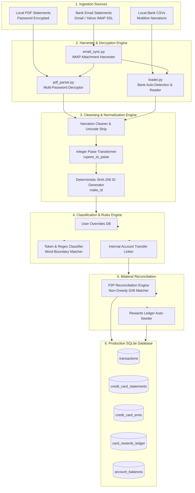

# Data Engineering Pipeline & Ingestion Specification
**Anti Gravity Finance OS — Data Pipeline Engineering Manual**
*Target Audience: Data Engineers, Analytics Engineers, ETL Developers, and Platform Engineers*

---

## 1. Overview & Pipeline Topology

The Data Engineering subsystem within Finance OS is responsible for ingesting, decrypting, normalizing, categorizing, and reconciling heterogeneous multi-bank and credit card data streams. 

### End-to-End Data Flow Pipeline



---

## 2. Ingestion & Connector Engines

### 2.1 Automated Email Statement Harvester (`email_sync.py`)
- **Protocol**: Secure IMAP over TLS (`port 993`).
- **Target Providers**: Gmail (`imap.gmail.com`) and Yahoo Mail (`imap.mail.yahoo.com`).
- **Search Criteria**:
  ```python
  # Search query filters for financial statement notifications
  criteria = '(OR FROM "axisbank" FROM "hdfcbank" FROM "icicibank" FROM "scapia" FROM "americanexpress" FROM "idfcfirstbank") SINCE <days_back>'
  ```
- **Security & Hygiene**:
  - Downloads attachments into temporary quarantine directory `data/statements/email_downloads/`.
  - Passwords and email credentials read from environment variables; zero hardcoding.

---

### 2.2 PDF Statement Parser & Decryptor (`pdf_parser.py`)
Bank PDF statements in India are encrypted using combinations of PAN numbers, date of birth (`DDMM`, `DDMMYYYY`), or name prefixes.

#### Decryption Engine:
```python
def open_encrypted_pdf(pdf_path: Path, candidate_passwords: list[str]) -> pypdf.PdfReader:
    reader = pypdf.PdfReader(str(pdf_path))
    if not reader.is_encrypted:
        return reader
    for pwd in candidate_passwords:
        try:
            if reader.decrypt(pwd) > 0:
                return reader
        except Exception:
            continue
    raise DecryptionError(f"Failed to decrypt {pdf_path.name} with provided passwords.")
```

#### Extraction Capabilities:
1. **Metadata & Statement Dues**:
   - Total Amount Due, Minimum Amount Due, Due Date, Statement Date.
   - Credit Limit, Available Credit Limit, Cash Limit.
   - Reward Points Earned, Reward Points Balance.
2. **Active EMI Schedules**:
   - Parses active EMI tables embedded in Axis, IDFC, Amex, and YES Bank statements.
   - Extracts: Merchant Name, Original Loan Amount, Monthly EMI, Total Tenure, Paid Tenure, Remaining Tenure.

---

### 2.3 Multiline CSV Parsing & Bank Auto-Detection (`loader.py`)
State Bank of India (SBI) and several regional banks output narrations that span 2 to 4 physical CSV rows without quote escaping.

#### Bank Auto-Detection Heuristic:
```python
def detect_bank_format(first_chunk: str) -> str:
    content = first_chunk.lower()
    if "axis bank" in content or "chq no" in content:
        return "axis"
    elif "state bank of india" in content or "txn date" in content and "value date" in content:
        return "sbi"
    elif "kotak" in content or "cr/dr" in content:
        return "kotak"
    return "generic"
```

#### Multiline Narration Unroller:
If a row does not start with a valid date token (`YYYY-MM-DD` or `DD-MM-YYYY`), the parser unrolls and concatenates the text back into the preceding row's description buffer, stripping rogue linefeeds and extra spaces.

---

## 3. Data Normalization & Cleansing

### 3.1 Deterministic SHA-256 Primary Key
To ensure complete idempotency when monthly statements overlap or are imported multiple times:

$$\text{Canonical String} = \text{account} \mid \text{txn\_date} \mid \text{strip\_whitespace}(\text{uppercase}(\text{desc})) \mid \text{amount\_str}$$
$$\text{id} = \text{SHA256}(\text{Canonical String})$$

This guarantees that re-importing the same CSV or PDF will result in `0 inserted, N skipped`, eliminating duplicate entries without requiring manual intervention.

---

### 3.2 Exact Integer-Paise Precision Architecture
Standard IEEE 754 floating-point numbers exhibit binary representation errors:
- $0.29 \to 0.2900000000000000355...$
- $19.99 \to 19.98999999999999843...$

In personal finance, these micro-drifts prevent exact reconciliation. Finance OS enforces strict integer paise precision:

```python
def rupees_to_paise(amount_inr: float | str) -> int:
    """Convert INR float to exact integer paise without floating-point error."""
    # Rounding at 2 decimal digits before casting prevents binary float drift
    return int(round(float(amount_inr) * 100))

def paise_to_rupees(amount_paise: int) -> float:
    """Convert integer paise back to standard display rupees."""
    return round(amount_paise / 100.0, 2)
```

Both values (`amount` REAL and `amount_paise` INTEGER) are stored in the database, with indexes built directly on `amount_paise`.

---

## 4. Classification & Rule Engine

Every row is classified into one of 8 canonical classes:
1. `income`: Salary or professional revenue.
2. `other_income`: Cashbacks, refunds, dividends.
3. `spend`: True consumption / lifestyle expenditure.
4. `internal_transfer`: Transfers between own accounts (Axis $\leftrightarrow$ SBI $\leftrightarrow$ Kotak).
5. `cc_payment`: Bill payment to credit card companies.
6. `friend_deposit`: Inbound pass-through money from friends (e.g. Ashwin).
7. `investment`: Mutual funds, SIPs, fixed deposits, stocks.
8. `fee`: Bank charges, annual card fees, interest.

### Tokenizer Matching with Word Boundaries
To eliminate false positives (e.g., merchant names containing substrings of categories), regexes enforce word boundaries:
```python
REGEX_RULES = {
    "Groceries": r"\b(blinkit|zepto|bigbasket|instamart|swiggy instamart|nature's basket)\b",
    "Food & Dining": r"\b(swiggy|zomato|mcdonald|starbucks|domino|eats)\b",
    "Transport & Fuel": r"\b(uber|ola|rapido|hpcl|bpcl|iocl|shell|metro)\b",
    "Utilities": r"\b(bescom|tatapower|airtel|jio|act fibernet|electricity)\b",
}
```

---

## 5. Bilateral Reconciliation & Drift Matching

### Problem:
A friend (Ashwin) makes credit card purchases on the user's card. The user pays the credit card bill, and Ashwin deposits money into the user's bank account. We must reconcile:
- Which CC bills were covered by which deposits?
- Is there an outstanding shortfall or surplus?

### Reconciliation Algorithm:
```python
def reconcile_deposits_against_bills(deposits_df, bills_df, tolerance_paise=100):
    """Bilateral matching with tolerance drift (default +/- Rs 1.00 = 100 paise)."""
    unmatched_bills = bills_df.copy()
    unmatched_deposits = deposits_df.copy()
    matched_pairs = []

    for dep_idx, dep in unmatched_deposits.iterrows():
        dep_paise = dep["amount_paise"]
        
        # Find bill where abs(bill_paise - dep_paise) <= tolerance_paise
        candidates = unmatched_bills[
            (unmatched_bills["amount_paise"] - dep_paise).abs() <= tolerance_paise
        ]
        
        if not candidates.empty:
            # Pick closest in time
            best_match = candidates.iloc[0]
            matched_pairs.append((dep["id"], best_match["id"]))
            unmatched_bills.drop(best_match.name, inplace=True)
            
    return matched_pairs, unmatched_bills, unmatched_deposits
```

---

## 6. Testing, Invariants & Observability

The Data Engineering pipeline is validated via `tests/run_tests.py`, enforcing **82 continuous integration assertions**:

| Test Group | Assertion Target | Expected Invariant |
|:---|:---|:---|
| **Deduplication** | Re-import of statement file | `inserted == 0, skipped == N` |
| **Classification** | Coverage across all rows | 100% of rows assigned valid classification |
| **Paise Invariant** | Integer paise column consistency | `amount_paise == round(amount * 100)` for all rows |
| **Bilateral Matching** | Ashwin deposits paired with bills | `candidate_unmatched == 0` for clean synthetic fixtures |
| **Drift Tolerance** | Gateway rounding variance ($\pm ₹1.00$) | Pairs correctly without human intervention |
| **Rewards Persistence**| `card_rewards_ledger` auto-seed | Statement points parsed and seeded into ledger |
| **Database Integrity** | SQLite journal mode | `PRAGMA journal_mode == 'wal'` |
