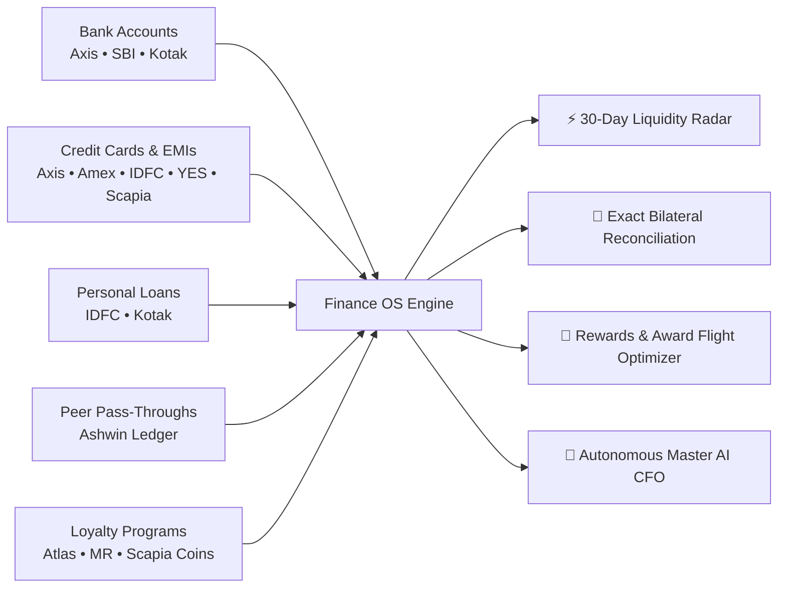
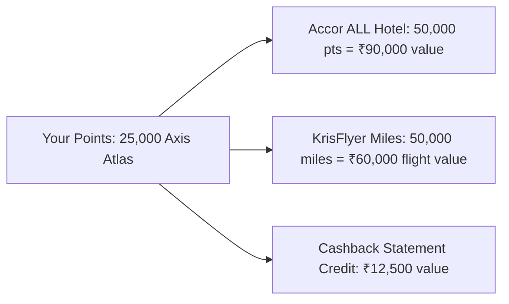

# Executive Presentation & User Operating Manual
**Anti Gravity Finance OS — Product Guide & Stakeholder Presentation**
*Target Audience: End Users, Executives, Product Managers, and Financial Advisors*

---

# PART I: Executive Presentation Deck (Product Vision & Strategy)

```
╔═════════════════════════════════════════════════════════════════════════════╗
║                                                                             ║
║                        ANTI GRAVITY FINANCE OS                              ║
║              Your Private, Autonomous Personal CFO on Mac                   ║
║                                                                             ║
╚═════════════════════════════════════════════════════════════════════════════╝
```

---

### Slide 1: The Problem — Fragmented Financial Reality
Managing modern personal finances in India is overwhelming and disjointed:
- **Multiple Bank Accounts**: Salary enters Axis, savings sit in SBI, liquid reserves are parked in Kotak. Knowing your true cash position requires logging into 3 different portals.
- **Credit Card Sprawl & Shared Limits**: 5+ physical cards (Axis, Amex, IDFC, YES Bank, Scapia) with hidden consolidated limits and overlapping billing cycles.
- **Dozens of Active EMIs**: 35+ small gadget, travel, and shopping EMIs bundled into credit card statements, obscuring how much you actually owe.
- **Messy Peer-to-Peer Pass-Throughs**: Paying a friend or family member's credit card bills and trying to track whether their bank transfers covered the full expense.
- **Wasted Reward Points**: Thousands of reward points expiring or redeemed for sub-optimal gift cards instead of ₹1.80/pt luxury hotel transfers or international business class award flights.

---

### Slide 2: The Solution — Anti Gravity Finance OS
A unified, private desktop operating system running locally on your computer that automatically ingests, reconciles, and optimizes your entire financial universe.



---

### Slide 3: Key Value Pillars

| Pillar | Capability | Real-World User Benefit |
|:---|:---|:---|
| **1. Zero-Leak Privacy** | 100% local SQLite storage. No banking credentials sent to cloud servers. | Your financial net worth and transaction history remain strictly private. |
| **2. Proactive Radar** | 30-day forward-looking cashflow simulator. | Never get hit with an auto-debit bounce or credit card late fee again. |
| **3. Exact Reconciliation** | Integer-paise precision matching for friend pass-throughs. | Know down to the exact rupee if someone owes you money or if you're settled. |
| **4. Points Maximizer** | Loyalty valuation graph across Accor, KrisFlyer, Qatar, and Marriott. | Turn 20,000 idle card points into ₹72,000 of 5-star hotel stays or award flights. |
| **5. Master Financial AI** | Policy-driven AI agent with 15+ specialized local financial tools. | Ask natural questions like *"Can I afford a ₹75,000 trip to Japan this month?"* and get instant math. |

---

# PART II: User Operating Manual & Feature Walkthrough

## 1. Navigating the 10 Dashboard Tabs

```
[Overview] [30-Day Radar] [Ashwin Recon] [Credit Cards] [Rewards & Miles]
[Bank Loans] [Transactions] [Master AI] [Upload] [History & Logs]
```

---

### Tab 1: 📊 Overview & Net Worth Command Center
- **Live Liquid Net Worth**: Displays total combined cash across Axis Bank, State Bank of India, and Kotak Mahindra Bank.
- **Running Ledger Balance Sync**: Balances automatically synchronize with the latest transaction rows from imported statements.
- **Cashflow Breakdown**: Shows true monthly salary income vs. lifestyle spend vs. credit card dues.

---

### Tab 2: ⚡ 30-Day Proactive Liquidity Radar
The Liquidity Radar models your bank balances over the next 30 days, simulating salary credits, upcoming credit card deadlines, and loan auto-debits.

```
Expected Cash Inflows (Salary + Deposits)
                   ▼
  [ Day-by-Day Balance Projection Curve ]
                   ▲
Expected Outflows (CC Bills + EMIs + Rent)
```

- **Urgent Warnings**: Alerts you in red if any account is projected to dip below its minimum balance threshold before payday.
- **Smart Transfer Recommendations**: Tells you exactly how much money to move from your surplus account (e.g. Kotak) to your billing account (e.g. Axis) to guarantee zero payment bounces.
- **"What-If" Expense Simulator**: Test discretionary purchases (e.g., *"What if I buy a ₹60,000 iPhone today?"*) to see how it affects your month-end liquidity.

---

### Tab 3: 👥 Ashwin Pass-Through Ledger & Reconciliation
Dedicated accounting module for managing pass-through credit card spending and bank deposits:
- **Net Position**: Instant summary indicating whether Ashwin owes you money or if the ledger is balanced.
- **Bilateral Matching Table**: Shows which credit card bills have been paired with incoming deposits.
- **Tolerance Drift ($\pm ₹1.00$)**: Automatically matches deposits that differ by pennies due to payment gateway charges.
- **Manual Overrides**: Click to manually pair or unpair specific transactions.

---

### Tab 4: 💳 Credit Cards & Active EMI Matrix
- **Shared Limit Tracking**: Correctly represents unified credit pools (e.g., Axis Bank's ₹3,00,000 shared limit across two physical cards).
- **Consolidated Statement Dues**: Shows Total Due and Due Date for every card.
- **35+ Active EMI Schedules**: Complete amortization table detailing the original loan amount, monthly installment, paid tenure, and remaining tenure for every purchase.

---

### Tab 5: 🎯 Rewards & Miles Optimizer
Maximizes the real-world value of your reward points and helps you book award travel:



#### Sub-Features:
1. **Points Portfolio Manager**: View and edit points across Axis Atlas, Amex, IDFC FIRST, YES Bank, and Scapia Federal. Auto-seeds points from imported statements.
2. **Where Best to Use My Points**: Direct comparison of Hotel Transfers, Airline Miles, Vouchers, and Cashback. Highlights the **Sweet Spot** for each card.
3. **✈️ Flight Booking Optimizer**:
   - Select route (e.g. *India ⇄ Singapore / SE Asia*, *India ⇄ Dubai*, *India ⇄ London*, *Domestic India*).
   - Enter cabin class (Economy or Business) and cash fare.
   - Click **⚡ Calculate Best Way to Book**:
     - 🏆 **Top Award Seat**: Exact transfer ratio, points required, taxes/copay, and net cash saved.
     - 🥈 **Portal Alternative**: Using Scapia Coins or YES Cart points.
     - 💳 **Cash Booking Return**: Which card to swipe if paying cash (e.g., Axis Atlas earning 10% on direct airline bookings).

---

### Tab 6: 🏦 Bank Loans & Debt-Free Amortization Tracker
- Tracks personal, NBFC, and auto-debit loans (IDFC, Kotak, etc.).
- Displays remaining principal, monthly EMI, debit day, and months until debt-free.
- Integrated with the Master Prepayment Advisor to calculate how much interest you save by making lump-sum prepayments.

---

### Tab 7: 🧾 Bank Transactions Ledger
- Unified searchable ledger across all accounts.
- Search by merchant name, date range, classification, or category.
- Inline category overrides: reclassify any transaction with a single click.

---

### Tab 8: 🧠 Master Financial AI Assistant
Your conversational CFO. Powered by LangGraph and armed with 15+ specialized local tools.

#### Example Questions You Can Ask:
- *"What is my true net cashflow after loan EMIs and credit card bills?"*
- *"What is the total amount Ashwin has sent to me this year?"*
- *"Can I afford to prepay ₹50,000 on my Kotak personal loan?"*
- *"Which points should I use to book a flight to Singapore?"*
- *"What is my latest Axis Bank balance?"*

---

### Tab 9: ☁️ Statement Ingestion & 1-Click Email Sync
- **1-Click Email Sync**: Connects to Gmail or Yahoo Mail over secure SSL IMAP to automatically download and parse the latest credit card statements and EMI schedules.
- **Manual Upload**: Drag and drop bank CSVs or password-protected PDFs.

---

### Tab 10: 📝 History & Audit Logs
- Browse past conversation sessions with the Master Financial AI.
- Full-text search across all previous questions and answers.
- Export transcripts as clean Markdown documents for personal records.

---

## 2. Monthly Close Checklist (Step-by-Step Playbook)

Follow this 5-minute routine at the start of each month:
1. **Sync Latest Statements**:
   - Open Tab 9 (`Upload`) or click **Sync Email** in the sidebar.
   - Let the harvester pull down your latest credit card PDFs.
2. **Review Liquidity Radar**:
   - Open Tab 2 (`30-Day Liquidity Radar`).
   - Check if any accounts have a projected deficit before upcoming credit card deadlines.
   - Execute any recommended internal transfers.
3. **Reconcile Pass-Throughs**:
   - Open Tab 3 (`Ashwin Reconciliation`).
   - Confirm whether all friend pass-through bills have been settled by incoming deposits.
4. **Optimize Reward Points**:
   - Open Tab 5 (`Rewards & Miles`).
   - Check your updated points balances and review transfer sweet spots before planning upcoming travel.
